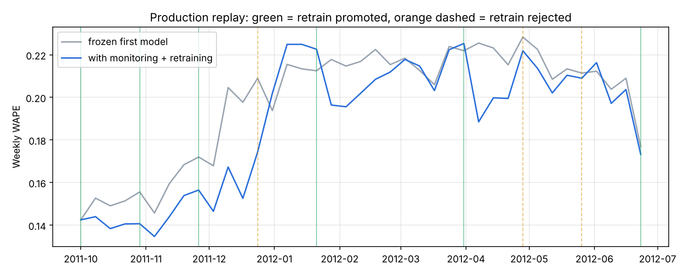

# mlops-demand-forecast

An end-to-end MLOps system for hourly demand forecasting: a model plus everything around it that keeps it right in production.

```
 data ─► validate ─► features ─► XGBoost ─► evaluate ─► MLflow registry ─► champion? ─► API (App Runner)
            │           (≥24h lags)    vs naive +     (params, metrics,    (beats current     │
            │                          backtest        signature, ref      by ≥2% on the      ▼
            ▼                                          sample)             same window)   prediction log (S3)
       fail loudly                                                                            │
                          Airflow: weekly train DAG  ◄── trigger ── daily monitor DAG ◄───────┘
                                                                     PSI/KS drift + live WAPE
```

| Piece | Tooling |
|---|---|
| Data | UCI Bike Sharing (hourly, 2011–12): demand roughly doubles, so drift is real |
| Validation | Schema, nulls, ranges, duplicate/missing hours; blocks training on bad data |
| Model | XGBoost with early stopping vs. seasonal-naive baseline; rolling-origin backtest |
| Tracking/registry | **MLflow**: params, metrics, artifacts, signature; aliases `champion` / `challenger` |
| Orchestration | **Airflow** DAGs: weekly training, daily monitoring with a branch to retrain |
| Monitoring | PSI + KS per feature, live WAPE vs. training WAPE, **Evidently** HTML report |
| Serving | FastAPI, pydantic input bounds, every prediction logged to S3 |
| Infra | **Terraform**: S3, ECR, App Runner, IAM, GitHub OIDC role (no static keys) |
| CI/CD | **GitHub Actions**: tests + `terraform validate` + Docker build; CD builds and pushes to ECR, App Runner auto-deploys |

## Production replay

`python -m mlops.simulate` trains on data before a start date, then replays every following week as "production". Each week it:
- forecasts the week
- scores the forecast once actuals arrive
- checks drift
- retrains if the rule fires, with a 4-week cooldown
- promotes only if the new model wins

**Synthetic sanity run** (CPU, ~1 min). Not a real-data claim:



| | Mean weekly WAPE | Mean weekly MAE |
|---|---|---|
| Frozen first model | 0.198 | 29.5 |
| With monitoring + retraining | 0.188 | 28.1 |

There were 9 retrains and 6 promotions; 3 challengers were rejected by the promotion rule.

**On the real UCI data:** _TBD after you run it_ (see below).

## Run it

```bash
pip install -r requirements.txt
python -c "from mlops.data import download; download()"          # data/hour.csv from UCI

# Local, no servers: MLflow writes to ./mlflow.db
set MLFLOW_TRACKING_URI=sqlite:///mlflow.db                          # (bash: export ...)
python -m mlops.train --data data/hour.csv
python -m mlops.simulate --data data/hour.csv --start 2012-01-01     # -> reports/simulation.png
mlflow ui --backend-store-uri sqlite:///mlflow.db                    # browse runs + registry

# Full local stack: MLflow server + API + Airflow
docker compose up -d --build        # MLflow :5000, API :8000/docs, Airflow :8080 (login printed in logs)
```

### Deploy to AWS (free-tier friendly; tear down with `terraform destroy`)
```bash
cd infra/terraform
terraform init
terraform apply -var github_repo=rohilutture/mlops-demand-forecast -var create_service=false
# add repo secret AWS_DEPLOY_ROLE_ARN = output github_deploy_role_arn; push to main -> CD pushes the image
terraform apply -var github_repo=rohilutture/mlops-demand-forecast           # now creates App Runner
curl $(terraform output -raw api_url)/health
```
Before pushing, run `python scripts/export_champion.py` (or set the `MLFLOW_TRACKING_URI` secret). That bakes the champion model into the image, so each image tag pins one exact model version.

## Tests
`pytest -q` runs 12 tests (about 1 min on CPU). They cover:
- **leakage:** changing y(t) must not change features(t); every lag is ≥24h old
- the ordering of the time split
- validation failures
- metric math, PSI on stable vs. shifted data, the retrain rule
- training beats naive; promotion (first model promoted, identical retrain stays challenger)
- bad data blocks training
- backtest folds
- the API predicts and logs, and rejects out-of-range input
- the replay loop runs and respects the cooldown

The tests already caught one real bug. The int32 calendar features from pandas didn't match the int64 values JSON sends at serving time, and MLflow's signature check rejected the mismatch. All model inputs are now float64.

See **[DESIGN.md](DESIGN.md)**.
